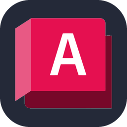

# Hey there!

Welcome to my corner of GitHub. I write everything from high-level apps down to hand-tuned assembly.  You'll get to meet me if you attend Defcon or Saintcon.  Sometimes I'm even breaking things at 801 Labs. I'm also a late night owl participating in TraceLabs finding missing persons or failing miserably at the CTF challenge. 

"The only way out.. Is through.."

### The Tech Stack
*The tools I use to build things:*

  &nbsp;
  &nbsp;
  &nbsp;
  &nbsp;
  &nbsp;
  &nbsp;
  &nbsp;
  &nbsp;
  &nbsp;
  &nbsp;
  &nbsp;
  &nbsp;
  &nbsp;
  &nbsp;
  &nbsp;
  &nbsp;
  &nbsp;
  &nbsp;
  &nbsp;
  &nbsp;
  &nbsp;
  &nbsp;
  &nbsp;
  &nbsp;
  &nbsp;
  &nbsp;
  &nbsp;
  &nbsp;
  &nbsp;
  &nbsp;
  &nbsp;
  &nbsp;
  

## My contribution history, two ways

<picture>
  <source media="(prefers-color-scheme: dark)" srcset="https://raw.githubusercontent.com/GUNSTAR1/GUNSTAR1/output/github-contribution-grid-snake-dark.svg">
  <source media="(prefers-color-scheme: light)" srcset="https://raw.githubusercontent.com/GUNSTAR1/GUNSTAR1/output/github-contribution-grid-snake.svg">
  
</picture>

### OR

---

### GitHub Trophies

### Public activity highlights

These ranks come from the third-party [lowlighter/metrics achievements plugin](https://github.com/lowlighter/metrics/blob/v3.34/source/plugins/achievements/README.md). GitHub does not publish or endorse them.

  

